# 👋

**Web Development · Backend · Problem Solving**

Learning software engineering fundamentals.

---

### `$ whoami`

<pre>
├── 💻 Focus — Web & Backend Development
├── 🧠 Problem Solving — C++ / DSA
└── 🌐 Status — Always learning, always building
</pre>

### `> stats` (Public + Private)

  
  

### `> tech`

  

**Working with** `TypeScript` · `React` · `JavaScript` · `Next JS` · `Git` · `GitHub` · `MySQL`

**Exploring next** `React` · `Backend Development` · `APIs`

### `> currently`

<pre>
building:      Web development projects
learning:      JavaScript → React → Backend
practicing:    C++ & Data Structures
improving:     Git workflows & project documentation
</pre>

---

**Build. Break. Debug. Repeat.**

Always learning — one commit at a time.

